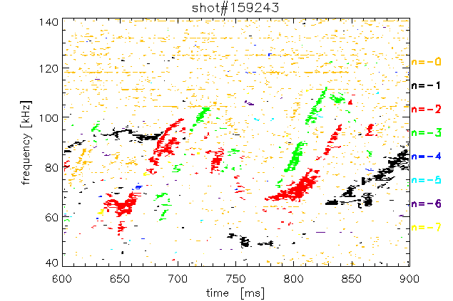

This folder contains two different codes. Both allow to get the end number of a fluctuation

# Toroidal fit


| Maintainer | Bill Heidbrink                                                      |
| ---------- | ------------------------------------------------------------------- |
| Purpose    | Fit the n number of a given mdoe                                    |
| Git repo   | /fusion/projects/toolbox/energetic_particles/magnetics/toroidal_fit |

## General overview
This code load the data from the toroidal array of magnetic probes and fit the phase of their cross power to get the n number of the fluctuation.

based on codes in /u/heidbrin/idl/FFT/


## Usage

Load the ep module and open an idl command box

```bash
module load ep
idl
```

Within IDL
```idl 
a=toroidal_data(159243,600,900)   
b=toroidal_spectra(a) 
n=scan_fit(a,b,810.,nmin=0,nmax=8,fmin=80,fmax=140)
n=toroidal_fit(a,b,831,86.5, nmin=0,nmax=9)
```


# MP_nmode


| Maintainer | Unknown                                                             |
| ---------- | ------------------------------------------------------------------- |
| Purpose    | Fit the n number of a given mdoe                                    |
| Git repo   | /fusion/projects/toolbox/energetic_particles/magnetics/toroidal_fit |

## General idea
Compute toroidal mode numbers from toroidally-displaced set of Mirnov coils.

Give a nice 2D plot


## Usage
```bash
module load ep
idl
```


```idl
; CALLING SEQUENCE
; mp_nmode,shot,out,trange=trange,frange=frange

; EXAMPLE USAGE (produce the image from above)
mp_nmode,159243,trange=[600,900],frange=[40,140],ovr=.5
```
