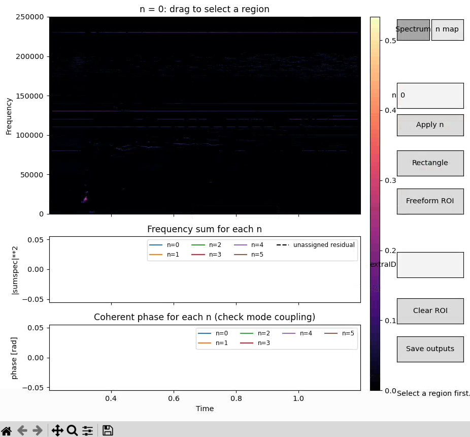
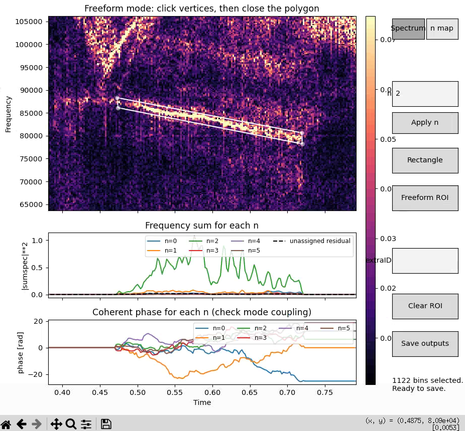
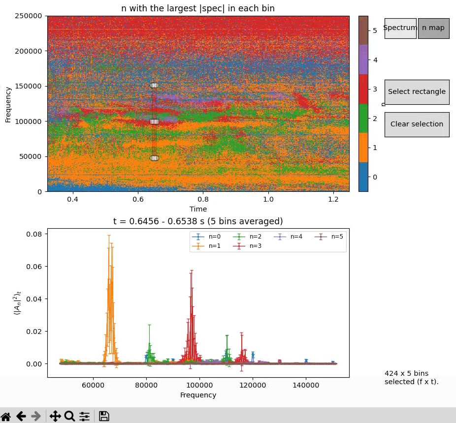

| Maintainer | Jose Rueda                                                               |
| ---------- | ------------------------------------------------------------------------ |
| Purpose    | Get the n number of a fluctuation based in its decomposition on the wall |
| Git repo   | Not yet released                                                         |

# General ideal

The code decomposes the signal of the different magnetics as a series of torodially symmetric functions. The default one is the sinusoidal wave, although a triangular or square wave can be selected if the user wants to play with different models. In the remaining of these notes, it is assumed that we are using the sinusoidal wave.


# Measurement model
Let probe `i` be located at toroidal angle `theta_i`, with measured signal `x_i(t)`. A wave with temporal frequency `f` and toroidal mode number `n` can be written as

  

$$

x_i(t) = Re{A \, \exp\left[j\left(2\pi f t - n\phi_i\right)\right]}.

$$
  
  

# Temporal Fourier transform

For every probe, `temporal_spectrum()` calculates a short-time Fourier transform (STFT). For a window centered near time `t_k`, the transform is approximately

  

$$

X_i(f,t_k) = \int x_i(\tau)w(\tau-t_k)\exp(-j2\pi f\tau)\,d\tau,

$$

  

where `w` is the selected window function. The default is a Hanning window.


The implementation stores:

  

```text

Xf.shape = (n_channels, n_freq, n_time_segments)

```

  

The frequency axis contains the positive frequencies returned by SciPy's `stft`,   


`nperseg` controls the temporal frequency resolution:

  

$$

\Delta f \approx \frac{f_s}{N_{\mathrm{segment}}},

$$

  

where $f_s$ is the sampling frequency. Increasing `nperseg` improves frequency resolution but gives fewer time segments and poorer time localization. `noverlap` controls the spacing between successive time segments; it does not fundamentally improve frequency resolution.

  


# Direct NUDFT projection


> [!Warning] Not recommended 
> This is a direct projection, use this is not recommended for the final product as unwanted cross terms are large, but might be useful to test some resolutions.

For the convention above, the positive-frequency component has approximately the spatial dependence

  

$$

X_i(f,t) \propto \exp(-jn\phi_i).

$$
 

Therefore, the direct projection onto candidate mode number `n` uses the opposite phase:

  

$$

S(n,f,t) = \frac{1}{N}\sum_{i=1}^{N}

X_i(f,t)\exp(+jn\phi_i).

$$

  

A true mode with number `n` produces a peak in $|S(n,f,t)|^2$ near that candidate. The method `toroidal_mode_spectrum()` computes the complex $S$ array with shape

  

```text

(n_modes, n_freq, n_time_segments)

```

  

The direct projection is useful and simple, but for irregular probe spacing its basis functions are not generally orthogonal. Consequently, power from one mode can leak into neighboring candidate modes.

  

# Simultaneous least-squares mode fit

  

`least_squares_mode_spectrum()` reduces this leakage by fitting all candidate modes simultaneously.

  

For a set of candidate mode numbers $n_1,\ldots,n_M$, define the design matrix

  

$$

H_{i,m} = \exp(-jn_m\phi_i),

$$

  

where `i` indexes probes and `m` indexes candidate modes. At each frequency and time segment, the model is

  

$$

\mathbf{X}(f,t) \approx H\mathbf{A}(f,t),

$$

  

where

  

$$

\mathbf{X}(f,t) =

\begin{bmatrix}

X_1(f,t)\\

\vdots\\

X_N(f,t)

\end{bmatrix},

\qquad

\mathbf{A}(f,t) =

\begin{bmatrix}

A_{n_1}(f,t)\\

\vdots\\

A_{n_M}(f,t)

\end{bmatrix}.

$$

  

With equal probe weights, the least-squares estimate is

  

$$

\widehat{\mathbf{A}}

= (H^H H)^{-1}H^H\mathbf{X}.

$$

  

The returned `xarray.DataArray` is the complex fitted mode amplitude:

  

```text

mode_amplitude.dims == ('n', 'freq', 't')

```

  

The fitted mode power is

  

$$

P(n,f,t) = |A_n(f,t)|^2.

$$

  

Use the complex amplitude when phase information is important; use its squared magnitude when locating mode peaks.

  

# Optional probe weights


> [!Warning] I never tested this
> Implementing it was trivial because the scipy functions which does the fits have weights as an argument, but I never use other weights different from 1 


The method accepts one positive weight per probe. With

  

$$

W = \operatorname{diag}(w_1,\ldots,w_N),

$$

  

the weighted fit is

  

$$

\widehat{\mathbf{A}}

= (H^HWH)^{-1}H^HW\mathbf{X}.

$$

  

The weights should represent relative confidence in each probe. For example, a probe with twice the noise variance should generally receive a smaller weight. If the noise standard deviation is $\sigma_i$, inverse-variance weighting uses

  

$$

w_i = \frac{1}{\sigma_i^2}.

$$

  

In the implementation, `weights=None` means all probes receive weight one. Weights are expected to be positive; zero-weight probes should be removed from the input instead.

  

Example:

  

```python

weights = 1.0 / noise_std**2

amplitude = arr.least_squares_mode_spectrum(

n_range=np.arange(-6, 7),

weights=weights,

regularization=regularization,

)

```

  

# Ridge regularization

  

If candidate modes are difficult to distinguish with the available probe geometry, the matrix $H^HWH$ can be ill-conditioned or singular. Ridge regularization replaces the fit with

  

$$

\widehat{\mathbf{A}}

= (H^HWH + \lambda I)^{-1}H^HW\mathbf{X},

$$

  

where $\lambda\geq0$ is the regularization parameter.

  

Regularization adds $\lambda$ to every eigenvalue of the weighted Gram matrix:

  

$$

G = H^HWH,

\qquad

\lambda_k(G+\lambda I)=\lambda_k(G)+\lambda.

$$

  

This stabilizes the inversion when small eigenvalues amplify noise. The tradeoff is that a large value biases fitted amplitudes toward zero and can blur or suppress weak modes.

  

# Choosing regularization from eigenvalues

  

`suggest_regularization()` examines the eigenvalues of $G$ and chooses the smallest nonnegative $\lambda$ for which the regularized condition number is below `target_condition`.

  

Let $\mu_{\max}$ and $\mu_{\min}$ be the largest and smallest eigenvalues of $G$. The condition number after regularization is

  

$$

\kappa_\lambda

= \frac{\mu_{\max}+\lambda}{\mu_{\min}+\lambda}.

$$

  

The method solves

  

$$

\kappa_\lambda \leq \kappa_{\mathrm{target}},

$$

  

which gives

  

$$

\lambda \geq

\frac{\mu_{\max}-\kappa_{\mathrm{target}}\mu_{\min}}

{\kappa_{\mathrm{target}}-1}.

$$

  

The returned value is the maximum of this expression and zero.

  

`target_condition` is a numerical stability limit, not a physical parameter:

  

- Smaller values, such as `1e2`, give stronger stabilization and more bias.

- `1e3` is a reasonable initial value.

- Larger values, such as `1e4` or `1e5`, preserve more of the unregularized fit but tolerate greater sensitivity to noise.

  

Example:

  

```python

n_range = np.arange(-6, 7)

regularization, eigenvalues = arr.suggest_regularization(

n_range=n_range,

weights=weights,

target_condition=1e3,

)

  

amplitude = arr.least_squares_mode_spectrum(

n_range=n_range,

weights=weights,

regularization=regularization,

)

power = abs(amplitude)**2

```

  

The eigenvalues are also a diagnostic. A very small minimum eigenvalue means that the selected modes are poorly distinguishable using the current probe angles, regardless of the amount of time data available.

  

#  Mode-window diagnostic

  

`mode_window()` measures how the angular probe geometry responds to a mode-number separation $\Delta n$:

  

$$

W(\Delta n) = \frac{1}{N}

\left|\sum_{i=1}^{N}\exp(j\Delta n\phi_i)\right|.

$$

  

At zero separation, $W(0)=1$. Large values away from zero indicate that two modes separated by that $\Delta n$ have similar phase patterns at the available probes and can be difficult to distinguish.

  

The squared response

  

$$

|W(\Delta n)|^2

$$

  

is a relative power-leakage measure. `plot_mode_window(power=True)` plots this power response.

  

Example:

  

```python

window = arr.mode_window(np.arange(-15, 16))

arr.plot_mode_window(np.arange(-15, 16), power=True)

```

  

The mode window is determined entirely by the probe angles. More time samples improve frequency statistics, but they cannot remove a spatial ambiguity already caused by the angular layout.

  

# Recommended Workflow

The recommended workflow to run this code have 2 steps:
- Decompose the power for all coils in their respective n numbers (Block 1 of scripts)
- Plot the results with an interactive GUI and save each mode data (Block 2 of scripts)

To run both, you need to load the proper python env, for this, just run:

```
module purge
module load defaults
module use /fusion/projects/toolbox/energetic_particles/modules
module load toroidal_NUDFT
```

## Block 1
There are 3 scripts which can be executed to run this code. Each of them solve the same linear system of equations with a bit of regularization to get the decomposition. There is only the different of which bins in (f,t) space are used:
- `NUDFT.py`: Solve the linear set of equations in all points of the f,t space.
- `NUDFTcoherence.py`: Solve the linear set of equations only in those points of the f,t space which have a given minimum coherence with an external signal (selected passing the name of the signal to load). A point (f,t) is solved if the mean coherence with all array of coils is above a given value
- `NUDFTcoherenceCoil.py`: Solve the linear set of equations only in those points of the (f,t) which are coherence with one choosen coil. For each (f,t) it only uses the data of the coils which pass a coherence threshold; ie, some points will use 10 coils, others 8, etc.

Executing any of this 3 scripts create in the output path 4 files:
- png with the selected variable (amplitude or power) for each n
- h5 file containing the power of the modes as a function of (n,f,t)
- h5 file containing the amplitude of the modes as a function of (n,f,t)
- h5 file containing the residual power of the fit

### Shared arguments:
```
python /fusion/projects/toolbox/energetic_particles/magnetics/toroidal_fit/NUDFT.py --help

options:
  -h, --help            show this help message and exit
  --shot SHOT           DIII-D shot number
  --fmin FMIN           Minimum frequency for analysis [kHz]
  --fmax FMAX           Maximum frequency for analysis [kHz]
  --tmin TMIN           Minimum time for analysis [s]
  --tmax TMAX           Maximum time for analysis [s]
  --nmin NMIN           Minimum toroidal mode number for analysis
  --nmax NMAX           Maximum toroidal mode number for analysis
  --nfft NFFT           Number of points for FFT analysis
  --vmax VMAX           Maximum value for color scale in plots
  --outputPath OUTPUTPATH
                        Output path for the analysis results
  --var VAR             power or amplitude (for plotting)
  --restrictFit         Fit only inside the fmin-fmax band (default is fit all)
  --coils COILS         List of coil angles to use for analysis
```

### NUDFTcoherenceCoil specific 
```
  --refCoil            coil to use as reference
```

> [!Warning] This is not my best coding
> refCoil is the coil to use as reference, but in the list of coils. Imagine you give as coils list [20, 125, 306, 345] and want to use 345 as reference, you need to indicate 3 here, as the 4th element of a python array is the index 3
>
### NUDFTcoherenceCoil specific 
```
  --coherenceVar            pointName of the signal to load
```

## Block 2: Visualization and export
This GUI allows you to see the data stored in the file and save subsection of the data assigned to a particular mode.

The script is: `IntegralSpectrum.py`. To run it, load the same module as for block 1 and then just:
```
python /fusion/projects/toolbox/energetic_particles/magnetics/toroidal_fit/IntegralSpectrum.py --shot --path
```

The list of arguments is:
``` 

/fusion/projects/toolbox/energetic_particles/magnetics/toroidal_fit/IntegralSpectrum.py --help

options:
  -h, --help            show this help message and exit
  --shot SHOT           DIII-D shot number
  --path PATH           Path to the folder with spectraFiles
  --smoothTime SMOOTHTIME
                        Smoothing window in milliseconds
```
`Path` is basically the folder used in block 1. `shot` is the shot number, to look for the proper files in that folder, `smoothTime` is just the window to use when integrating the spectrum. Default is 5 ms

After launching, user will see this window:


Writing a given n number and clicking "Apply n" shows only the spectra for that n. leaving the n box wit no input shows the rms for all ns

You can change the color bar clicking on the zoom buttom and zooming in the color axis.

To define a ROI, click on Freeform, to select custom ROIS, or rectangle

After selecting the ROI, the 2 plots below with phase and amplitude information for each n will be filled below. You cannot define a new ROI without cleaning the previous one.

To save it, write a name in the box 'extraID' and click "save outputs"

The tab 'nmap' shows the spectrum as a function of n numbers, not power, and allows to get n vs f plots:




# Practical limitations

- With `N` probes, fitting too many candidate modes creates an underdetermined or poorly conditioned problem. Keep the candidate range modest. n=0...5 seems reasonable

- Probe calibration differences can mimic toroidal phase.

- The implementation assumes a common, approximately uniform time base for all channels.

- The current analysis uses the positive-frequency complex STFT supplied by the input signals. No negative-frequency combination is required.

- Regularization stabilizes the numerical fit; it cannot recover spatial information that the probe geometry does not contain.